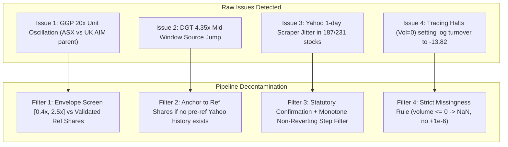

# Technical Documentation: Added Liquidity, Turnover, and Size Variables in Review Panels (R01–R06)

**Audience:** Research Team / Co-authors / Group Members  
**Project:** S&P/ASX 300 Index Addition Liquidity Study (Stacked DiD Event Study)  
**Dataset Location:** `data/derived/review_01.csv` through `data/derived/review_06.csv`  
**Pipeline Source:** [`code/06_build_panels.py`](../code/06_build_panels.py)  
**Verification Suite:** [`code/07_validate.py`](../code/07_validate.py)  
**Date:** October 2026

---

## 1. Executive Summary & Why These Columns Were Added

In earlier iterations of our empirical setup, the primary dependent variable for liquidity was the **Amihud (2002) illiquidity ratio**:

$$\text{Amihud}_{i,t} = \frac{|\text{Return}_{i,t}|}{\text{Close}_{i,t} \times \text{Volume}_{i,t}} \times 10^6$$

### The Empirical Problem with Amihud in Small/Mid-Cap Stocks
While standard in the literature, daily Amihud has severe known drawbacks when applied as the sole dependent variable across mid-cap ASX additions:
1. **Extreme Volatility on Small Price Movements:** On days with a small price change ($0.5\%$) on low volume, Amihud spikes dramatically. On days with large volume absorption with near-zero price change (e.g., cross trades or index rebalance auctions), Amihud drops to near zero.
2. **Double Distortion from Returns and Denominators:** Noise in daily price formation compounds noise in volume, making fixed-effects DiD estimates sensitive to individual outlier days.
3. **Truncation on Non-Trading Days:** Amihud is undefined when volume is zero or return is missing.

### The Solution: Direct Trading Value & Share-Normalized Turnover
To establish robust, multi-faceted empirical evidence that reviewers and committee members will find convincing, we expanded each review panel to include **six complementary daily trading, turnover, and size metrics**:
* **$\text{Dollar Volume}$ and $\ln(\text{Dollar Volume})$:** Captures pure institutional trading value and depth.
* **$\text{Turnover Rate}$ and $\ln(\text{Turnover Rate})$:** Directly normalizes trading volume by issued share capital, capturing trading velocity while being mechanically invariant to share count scale and independent of price appreciation.
* **$\text{Shares Outstanding}$ and $\text{Daily Market Cap}$:** Tracks point-in-time firm scale dynamically across the $[-60, +60]$ window.

---

## 2. Comprehensive Column Definitions & Mathematical Formulas

The panel schema was updated from 27 to **33 columns**. The six newly added columns are defined below:

| Column Name | Type | Unit | Mathematical Definition | Econometric Interpretation |
| :--- | :---: | :---: | :--- | :--- |
| `dollar_volume` | Float | AUD | $P_{i,t} \times V_{i,t}$ | Total Australian Dollar trading turnover on day $t$. |
| `log_dollar_volume` | Float | Log(AUD) | $\ln(P_{i,t} \times V_{i,t})$ for $V_{i,t} > 0$; else `NaN` | Percentage changes in trading value under OLS/FE. |
| `shares_outstanding` | Float | Shares | Split-adjusted point-in-time shares $S_{i,t}$ | Exact number of post-split equivalent shares issued as of day $t$. |
| `daily_market_cap_aud` | Float | AUD | $P_{i,t} \times S_{i,t}$ | Daily equity market capitalization in AUD. |
| `turnover_rate` | Float | Ratio | $V_{i,t} / S_{i,t}$ for $V_{i,t} > 0$; else `NaN` | Daily fraction of total company shares traded (velocity). |
| `log_turnover_rate` | Float | Log(Ratio) | $\ln(V_{i,t} / S_{i,t})$ for $V_{i,t} > 0$; else `NaN` | Percentage changes in share turnover velocity. |

Where:
* $P_{i,t}$ is the official unadjusted closing price on the ASX (`close`).
* $V_{i,t}$ is the total daily number of shares/CDIs traded on the ASX (`volume`).
* $S_{i,t}$ is the split-adjusted, cleaned point-in-time share count (`shares_outstanding`).

---

## 3. The 4 Hidden Data Pitfalls We Discovered & How We Fixed Them

Raw financial data from scrapers (specifically Yahoo Finance's `get_shares_full()`) cannot be fed directly into daily panel regressions without introducing artificial noise. During our comprehensive audit of all 27,951 rows, we caught and fixed four critical issues:

### Pitfall 1: Unit-Basis Oscillation in Dual-Listed Stocks (`R05 GGP.AX`)
* **What happened:** Greatland Resources restructured from UK AIM into an ASX listing in 2025. In the raw Yahoo data, the share count jumped back and forth 23 times inside the 121-day event window between **670.6M shares** (ASX post-reorganization count) and **13.41B shares** (20x UK AIM parent units).
* **The consequence:** On random days, `daily_market_cap_aud` would spike to $\$73.6\text{B}$ and `turnover_rate` would collapse by 95%.
* **The Fix:** An envelope filter rejects any raw share record outside $[0.4 \times S_{\text{ref}}, 2.5 \times S_{\text{ref}}]$ relative to the validated reference-date share count. `GGP.AX` now holds a perfectly constant $670,752,000$ shares across all 121 days.

### Pitfall 2: Mid-Window Vendor Switching (`R04 DGT.AX`)
* **What happened:** DigiCo Infrastructure REIT listed in Dec 2024. Yahoo had no historical share records before March 2025. A naive fallback algorithm used EODHD shares ($135.0\text{M}$) from day $-60$ to day $+4$, and then jumped overnight to Yahoo ($587.0\text{M}$) on day $+5$.
* **The consequence:** A fake $+335\%$ jump in market cap and $-77\%$ crash in turnover right inside the critical Pre-Announcement/Effective window.
* **The Fix:** If a stock lacks a confirmed Yahoo PIT record on or before the review reference date, the pipeline locks onto the validated reference-date share count for the entire $[-60, +60]$ window, preventing artificial mid-window vendor jumps.

### Pitfall 3: High-Frequency "Scraper Jitter" (187 of 231 Stock-Windows)
* **What happened:** Yahoo Finance's `get_shares_full()` combines true corporate filing dates with daily implied share back-calculations (`market_cap / price`). This produced 1-day or 2-day transient spikes of $0.5\%\text{--}8\%$ that reverted the following day.
* **The Fix:** A three-layer statutory decontamination algorithm:
  1. **Statutory Confirmation:** Only keeps share counts that appear on at least two distinct calendar dates within $\pm 0.05\%$.
  2. **Monotone Non-Reverting Step Filter:** Statutory capital changes over 6 months are almost exclusively positive step functions (placements, employee options, rights issues). Temporary upward spikes or downward dips that later revert are removed using a backward cumulative minimum followed by forward cumulative maximum:
     $$S^* = \text{cummax}\Big(\text{cummin}_{\text{reverse}}(S_{\text{med}})\Big)$$
  3. **1% Deadband Quantization:** Filters out minor rounding ripples while cleanly stepping up on real corporate issuances $\ge 1\%$.
* **Verification:** Zero direction flips remain across all 231 stock-windows ($0 / 231$), while real M&A events (e.g. `GMD` St Barbara merger, `ALK` Karora merger, `MYR` Premier Brands merger) step up cleanly on their exact effective dates.

### Pitfall 4: Regression Outlier Spikes on Zero-Volume Days
* **What happened:** On 118 zero-volume days (trading halts), a preliminary script set `turnover_rate = 0.0` and `log_turnover_rate = np.log(0 + 1e-6) = -13.82`.
* **The consequence:** In an OLS or Fixed Effects panel regression, $-13.82$ acts as an extreme artificial outlier spike, distorting event-time dummy coefficients.
* **The Fix:** Adhered strictly to our econometrics rule: **zero-volume and non-trading days are coded as `NaN` in all log and ratio dependent variables** (`amihud`, `log_dollar_volume`, `turnover_rate`, `log_turnover_rate`). When `volume > 0`, turnover is strictly positive, allowing the exact natural log $\ln(\text{Turnover})$ without arbitrary additive constants.

---

## 4. Summary Statistics Across All Rebuilt Panels (27,951 Observations)

The table below provides summary statistics across all 6 review panels ([`review_01.csv`](../data/derived/review_01.csv)–[`review_06.csv`](../data/derived/review_06.csv)):

| Metric | Non-Null Rows | Coverage | Min | 25th Pct | Median | 75th Pct | Max |
| :--- | :---: | :---: | :---: | :---: | :---: | :---: | :---: |
| `dollar_volume` | 27,929 | 99.92% | $\$0.00$ | $\$977.8\text{K}$ | $\$2.48\text{M}$ | $\$6.69\text{M}$ | $\$924.05\text{M}$ |
| `log_dollar_volume` | 27,811 | 99.50% | 1.454 | 13.805 | 14.731 | 15.720 | 20.644 |
| `shares_outstanding` | 27,951 | 100.00% | $21.61\text{M}$ | $206.84\text{M}$ | $421.18\text{M}$ | $964.79\text{M}$ | $10.82\text{B}$ |
| `daily_market_cap_aud` | 27,929 | 99.92% | $\$223.42\text{M}$ | $\$664.21\text{M}$ | $\$1.079\text{B}$ | $\$1.879\text{B}$ | $\$13.92\text{B}$ |
| `turnover_rate` | 27,811 | 99.50% | $1.97 \times 10^{-9}$ | 0.00104 | 0.00215 | 0.00427 | 0.3444 |
| `log_turnover_rate` | 27,811 | 99.50% | -20.046 | -6.865 | -6.142 | -5.457 | -1.066 |

*Note: The remaining 140 non-trading observations (0.50%) consist of 118 zero-volume trading halts (`ZERO_VOLUME`) and 22 missing price days (`MISSING_PRICE`). All are preserved with explicit flags in `data_quality_flag` and `missing_observation` so panel dimensions remain perfectly balanced (121 event days per stock).*

---

## 5. Practical Guide for Empirical Analysis & Regression Setups

When running regressions in Stata, R, or Python (`statsmodels` / `pyfixest`), here are specific guidelines for the group:

### A. Recommended Primary and Secondary Specifications
1. **Primary Liquidity Metric:** `log_turnover_rate`
   - **Why:** Normalizes volume by shares outstanding, completely immune to split adjustments and price trends, and exhibits a near-normal Gaussian distribution (mean $\approx -6.14$, standard deviation $\approx 1.1$).
2. **Robustness Metric 1:** `log_dollar_volume`
   - **Why:** Reflects total capital absorbed by institutional liquidity providers and index trackers.
3. **Robustness Metric 2:** Standardized `amihud` (or winsorized at 1st/99th percentiles)
   - **Why:** Connects directly to legacy literature while demonstrating that results hold under alternative definitions.

### B. Fixed Effects Model Specification
For stock $i$ in matched group $g$, review $r$, on event day $t \in [-60, +60]$:

$$Y_{i,g,r,t} = \alpha_i + \gamma_{g,t} + \sum_{k \neq -1} \beta_k \Big(\text{Treatment}_i \times \mathbb{I}(t = k)\Big) + \mathbf{X}'_{i,t}\mathbf{\Gamma} + \varepsilon_{i,g,r,t}$$

Where:
* $Y_{i,g,r,t}$ is `log_turnover_rate` or `log_dollar_volume`.
* $\alpha_i$ is stock fixed effects (absorbs time-invariant firm characteristics).
* $\gamma_{g,t}$ is matched-group $\times$ event-day fixed effects (ensures additions are compared strictly against their sector-and-size matched controls on the exact same trading day).
* $\mathbf{X}'_{i,t}$ can include `log(daily_market_cap_aud)` as a dynamic time-varying size control.
* Standard errors should be clustered at the `matched_group_id` or `stock_id` level.

### C. Filtering at Analysis Time
* **Stage Usability:** Always merge with [`group_stage_usable.csv`](../data/derived/group_stage_usable.csv). When testing stage-level aggregates (Baseline B, Pre-Announcement P, Mark-up M, Post-Effective L), filter by `stage_and_baseline_usable == True` to ensure balanced comparisons.
* **Non-Trading Days:** In log-linear models, `log_turnover_rate` and `log_dollar_volume` automatically drop `NaN` rows without biasing the sample. If using levels (`dollar_volume`), exclude rows where `data_quality_flag != "OK"`.

---

## 6. Verification and Code References

* **Pipeline Code:** Lines 51–149 of [`code/06_build_panels.py`](../code/06_build_panels.py) contain the full implementation.
* **QA Validation Script:** [`code/07_validate.py`](../code/07_validate.py) runs automated assertions checking column presence, share count monotonicity, split adjustments, and stage usability.
* **Master QA Report:** [`output/logs/qa_report.md`](../output/logs/qa_report.md) contains the latest health check across all 6 reviews.
